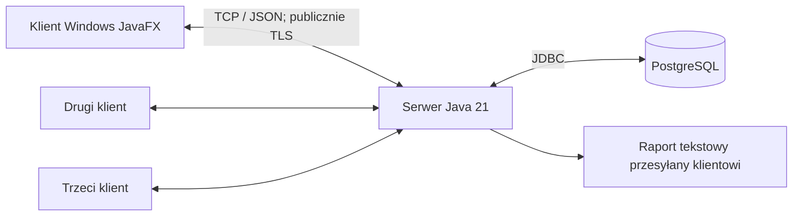

# Architektura i współbieżność

Dokument opisuje architekturę zaimplementowaną w wersji 1.0.0 oraz jej zasady. Uzasadnienie mechanizmów względem wykładów znajduje się w [źródłach](REFERENCES.md), a zakres wykonanych prób w [wynikach weryfikacji](VALIDATION_RESULTS.md).

## 1. Elementy systemu

Na laptopie wszystkie elementy mogą działać jednocześnie. To nadal komunikacja sieciowa przez TCP loopback. Nie jest to jednak dowód działania przez Internet. Docelowo przenosimy serwer i bazę; klient otrzymuje konfigurację stałej domeny podczas pakowania.

Jedna instancja serwera jest źródłem decyzji, PostgreSQL źródłem trwałych danych. Nie projektujemy klastra ani równoważenia ruchu pomiędzy wieloma serwerami aukcji.

## 2. Moduły Maven i odpowiedzialności

| Moduł | Zawartość | Ograniczenia |
|---|---|---|
| `common` | DTO, nazwy operacji, błędy, kodowanie ramek, walidacja formatu | Bez JavaFX, sterownika DB i haseł konfiguracji. |
| `server` | Domena, usługi, JDBC, migracje, sesje, automaty, transport, raporty | Bez zależności JavaFX. |
| `client` | JavaFX/FXML/CSS, połączenie, modele widoków, bufor logów | Bez JDBC i dostępu do bazy. |
| `loadtest` | Klienci bez GUI do kontrolowanych testów własnego serwera | Uruchamiany osobno, nie przy każdym buildzie. |

Rekordy `Auction`, `Bid`, `User` i enum `Status` znajdują się w `common/Models`. Logikę serwera rozdzielają `BidPolicy`, `AuctionService`, `AuthService`, `CommandService`, `ReportService` i `LogService`; JDBC obsługują `Database`, `Sql` i `AuctionRepository`. Zapytania kont i audytu są częścią odpowiednich usług. `AuctionRuntimes.Context` przechowuje stan jednego automatu `AuctionLifecycleTask`. Transport tworzą `ClientSessionHandler`, `Dispatcher`, `RpcConnection` i `FrameCodec`, a po stronie UI `ClientGateway` i `MainController`. Wstrzykiwany `Clock` umożliwia testy granic czasu.

## 3. Wątki i wykonawcy

Podstawą jest `java.util.concurrent`, przede wszystkim `ExecutorService`, `Callable`, `Future`, `ConcurrentHashMap`, `ReentrantLock`, `Condition`, `Semaphore` i kolejki o ograniczonej pojemności.

| Zadanie | Wykonanie |
|---|---|
| Przyjmowanie połączeń | Zadanie `Callable` zgłoszone do wykonawcy; przydziela limit połączenia przed obsługą. |
| Obsługa klienta | Jeden długotrwały `ClientSessionHandler implements Callable<Void>` na połączenie, osobny wątek wirtualny. |
| Wysyłanie do klienta | Osobne zadanie opróżniające jego ograniczoną kolejkę, aby powolny odbiorca nie blokował aukcji. |
| Automat aukcji | Jeden `AuctionLifecycleTask implements Callable<Status>` na opublikowaną nieterminalną aukcję; trwa od publikacji do końca/anulowania. |
| Logi diagnostyczne | Jedno zadanie zapisujące paczki z ograniczonej kolejki. |
| Kontrola sesji/heartbeat | `Callable` monitora serwera co sekundę sprawdza sesje, połączenia i eksporty; `Callable` klienta utrzymuje połączenie i wysyła PING co 15 s. Bez osobnego wątku na każdy licznik. |
| Klient JavaFX | Sieć i eksport poza wątkiem UI; zmiana kontrolek przez `Platform.runLater`. |

Wykonawca zadań klientów i automatów: `Executors.newVirtualThreadPerTaskExecutor()` w JDK 21. Każde zadanie otrzymuje własny wątek wirtualny, wykonujący się na zarządzanych przez JVM wątkach systemowych. Liczby wątków systemowych i klientów nie muszą być równe. Jest to nowoczesne rozszerzenie modelu wykonawców z wykładu, a nie ręczne zarządzanie `Thread`.

`Runnable` nie jest usuniętym ani przestarzałym interfejsem Javy; wykorzystują go także współczesne API. Wymaganie prowadzącego realizujemy przez architekturę opartą na wykonawcach, `Callable` i synchronizacji z `java.util.concurrent`, bez własnych klas `Thread` i ręcznego uruchamiania wątków. Technicznie wątki wirtualne także są wątkami Javy. W sprawozdaniu należy wyjaśnić to precyzyjnie, bez obietnicy „braku Thread w JVM”.

Limit połączeń i opublikowanych niezakończonych aukcji kontroluje konfiguracja oraz `Semaphore`; domyślnie 32 i 16. Szkic nie zajmuje automatu. Nadmiarowy socket jest zamykany przed utworzeniem zadania obsługi; klient pokazuje niedostępność i ponawia połączenie. Publikacja ponad limit zwraca `CAPACITY_REACHED`. Przydział jest zwalniany także przy błędzie. Zwiększenie limitów nie wymaga zmiany klas domenowych.

Przy publikacji najpierw zarezerwuj miejsce automatu, potem zatwierdź zmianę w DB i uruchom zadanie. Nie zwalniaj miejsca po samej odpowiedzi na publikację: pozostaje zajęte do końca zadania. Błąd przed commit zwalnia rezerwację. Jeśli uruchomienie zadania zawiedzie po commit, uzgodnij opublikowaną aukcję z DB i wznow automat przed dalszym przyjmowaniem zmian; nie zostawiaj aktywnej aukcji bez sterownika. Konkurujące edycje/publikacje szkicu chroni blokada wiersza i `expectedVersion`.

## 4. Automat jednej aukcji

`AuctionRuntimes.Context` zawiera własny `ReentrantLock`, `Condition`, ostatni zatwierdzony snapshot i uchwyt `Future`. Rejestr `ConcurrentHashMap<UUID, Context>` zapewnia jeden kontekst na aukcję w instancji serwera. Licznik referencji i `Lease` usuwają terminalny kontekst dopiero po zakończeniu zadania i operacji w toku. Odczyt zakończonej aukcji korzysta z DB i nie wskrzesza automatu.

Automat, w pętli pod blokadą:

1. Sprawdza stan i świeży czas serwera.
2. Dla `SCHEDULED` czeka do początku, następnie transakcyjnie przechodzi do `ACTIVE`.
3. Dla `ACTIVE` czeka do aktualnego `endAt`.
4. Po przebudzeniu ponownie odczytuje stan i czas; uwzględnia przedłużenie, anulowanie i pozorne wybudzenie.
5. Gdy czas minął, transakcyjnie zapisuje wynik, audyt i `FINISHED`.

Oczekiwanie przez `Condition.awaitNanos` zwalnia blokadę. Nie trzymaj podczas oczekiwania połączenia JDBC. Czas jednego oczekiwania ogranicz np. do 1 s, aby uwzględniać także korekty zegara systemowego; nie wysyłaj z tego powodu co sekundę zdarzeń sieciowych. Oferty i anulowanie wywołują `signalAll` po zatwierdzeniu nowego stanu. Przerwanie podczas wyłączania musi kończyć zadanie w kontrolowany sposób, a nie być ignorowane.

Zegar serwera (`Clock`/`Instant`) rozstrzyga terminy. Pomiar monotoniczny służy tylko do oczekiwania i lokalnego odliczania, nigdy do zapisu dat. Klient nie wyznacza czasu przyjęcia oferty. Jeśli automat jest opóźniony, oferta dla `SCHEDULED` nie jest przyjmowana, dopóki stan nie przejdzie do `ACTIVE`.

## 5. Atomowe przyjęcie oferty

Stała kolejność zasobów: **blokada konkretnej aukcji → połączenie z puli → blokada wiersza DB**. Nie stosuj odwrotnej kolejności w anulowaniu, zamykaniu ani odtwarzaniu. Operacje jednej aukcji są serializowane; różne aukcje mogą postępować równolegle, w granicach puli DB.

1. Uwierzytelnij sesję, zweryfikuj format i `requestId`, pobierz kanoniczny kontekst aukcji i jego blokadę.
2. W transakcji sprawdź aktywność konta z blokadą `FOR SHARE`. `CommandService` uzyskuje transakcyjną blokadę doradczą polecenia i odczytuje zapisany wynik. Zgodne powtórzenie wraca przed walidacją biznesową, także po końcu aukcji. Dla nowego polecenia pobierz aukcję przez `SELECT ... FOR UPDATE`.
3. Sprawdź aktualne uprawnienia, stan i świeże `now`, odczytane po uzyskaniu blokady wiersza. Zastosuj reguły z [wymagań](REQUIREMENTS.md), w tym zakaz własnej aukcji, minimalną kwotę i dokładny termin.
4. Wylicz nową cenę, lidera, numer oferty, termin i wersję. Zapisz ofertę, stan aukcji, audyt przyjęcia/przedłużenia oraz wynik polecenia w **jednej transakcji**.
5. Dopiero po udanym `commit` uaktualnij snapshot w pamięci i obudź automat. Zwolnij zasoby. Wyślij odpowiedź i powiadomienia bez blokowania aukcji zapisem do socketu.
6. Przy rollback nie publikuj spekulacyjnego stanu. Gdy wynik `commit` jest nieznany wskutek zerwania połączenia z DB, uzgodnij go z tabelą wyników poleceń na świeżym połączeniu. Do tego czasu zwróć stan niepewny/niedostępność, nie kategoryczne „nie zapisano”.

Klucz unikatowy `(user_id, request_id)` chroni przed powtórzeniem z innego połączenia. Konflikt tego samego ID z inną operacją/treścią oznacza `REQUEST_ID_CONFLICT`. Dwie transakcje tego samego polecenia serializuje blokada doradcza; druga odczytuje już zatwierdzony wynik pierwszej. HMAC kanonicznego DTO identyfikuje treść. Odrzucenie biznesowe jest zapisywane po rollback do savepointu; przejściowy błąd infrastruktury nie utrwala definitywnej porażki polecenia.

Zamknięcie i anulowanie używają tego samego porządku blokad oraz ponownego sprawdzenia terminu. Nie mogą zakończyć aukcji według starej daty. Nie ma jednej globalnej blokady obejmującej wszystkie aukcje.

## 6. Powiadomienia i stan klienta

Każda zmiana stanu zwiększa `auction.version`. Powiadomienie zawiera pełny publiczny snapshot, a nie samą różnicę ceny. Klient odrzuca starszą wersję; odpowiedź i zdarzenie mogą dotrzeć w różnej kolejności. Odpowiedź na duplikat może zawierać historyczny wynik — nie może cofnąć nowszego widoku.

Subskrypcja rejestruje obserwatora przed pobraniem snapshotu. Aktualizacja, która nastąpi w tym czasie, zostanie uwzględniona przez wersje. Po reconnect zawsze pobierz snapshot. Nie wymagamy trwałego dziennika wszystkich powiadomień ani brokera.

Na połączenie: ograniczona kolejka wyjściowa, np. najwyżej 128 ramek i 1 MiB, dodatkowo łączny budżet kolejek serwera np. 16 MiB w profilu laptopowym. Zapis tylko przez jednego nadawcę. Po przepełnieniu zamknij wolne połączenie, odnotuj zdarzenie; klient wznowi stan. Nie blokuj w nieskończoność producenta, nie usuwaj po cichu odpowiedzi na ofertę. Monitor może zamknąć socket nadawcy, którego zapis nie robi postępu.

## 7. Trwałość, restart i awaria bazy

Migracje poprzedzają otwarcie portu. Serwer uzyskuje pojedynczą blokadę instancji w PostgreSQL (session advisory lock na dedykowanym połączeniu, poza pulą operacji); druga instancja dla tej samej bazy nie startuje. Utrata tej blokady zatrzymuje przyjmowanie mutacji do ponownego uzgodnienia stanu. Nie obiecujemy odpornego klastra.

Przed gotowością serwer odtwarza opublikowane aukcje z DB, kończy już przeterminowane, aktywuje te, których start minął, i tworzy automaty dla pozostałych. Obowiązuje zapisany, przedłużony termin. Gdy nowy limit jest niższy niż liczba istniejących aukcji, nie pomijaj części: odmów gotowości i wskaż potrzebny limit. Restart nie wymazuje ofert ani wyników poleceń.

Przy braku DB: nowe oferty, rejestracje i zmiany są niedostępne. Ostatni widok klienta może pozostać z oznaczeniem nieaktualności. Po przywróceniu połączenia uzgodnij bazę, pamięć i zaległe zakończenia przed przyjmowaniem nowych zmian. Brak odpowiedzi nie jest dowodem braku zapisu.

Przy wyłączeniu: przestań przyjmować nowych klientów, pozwól bieżącym transakcjom zakończyć się w ograniczonym czasie, zamknij sesje, przerwij oczekiwania automatów, opróżnij logi lub zachowaj spool, zamknij wykonawców i pulę. Wyłączenie procesu nie zmienia automatycznie każdej aukcji na `CANCELLED`.

## 8. Logi i bezpieczeństwo

- Audyt biznesowy (oferta, przedłużenie, publikacja, zakończenie, anulowanie, zmiana uprawnień) zapisuj razem z odpowiednią transakcją. To historia rozstrzygająca o działaniu systemu.
- Diagnostykę serwera zapisuje osobny odbiorca paczek. Gdy DB nie działa, użyj ograniczonego trwałego pliku buforowego; po odzyskaniu DB odtwórz wpisy z deduplikacją.
- Klient buforuje zdarzenia lokalnie, np. uruchomienie, połączenie, rozłączenie, wysłanie polecenia, wynik/błąd. Przesyła paczki, usuwa je dopiero po potwierdzeniu trwałego zapisu. Nie loguj każdego odświeżenia zegara.
- Użytkownik logu pochodzi z sesji, nie z deklarowanego `userId`. Przed zalogowaniem wpis ma anonimowy kontekst; po przesłaniu zapisujemy osobno zgłaszającego. Zdarzenia klienta są deklaracjami klienta, nie zastępują audytu serwera.
- Bufor diagnostyczny ma limit, np. 10 MiB na proces i rotację; utratę starszych wpisów przy wyczerpaniu miejsca oznacz licznikiem. Nie obiecuj bezstratności przy pełnym dysku. Audytu transakcyjnego nie wolno pomijać tą metodą.
- Hasła: JCA PBKDF2-HMAC-SHA256, 600 000 iteracji, losowa sól 16 bajtów, wynik 32 bajty; parametry zapisane obok hasha. Bez własnej implementacji kryptografii.
- Równoległe haszowanie jest ograniczone do 2 operacji. `RateLimiter` dopuszcza 60 prób logowania/rejestracji na minutę/adres; w 1.0.0 jest to stała kodu. Po wyczerpaniu limitu zwraca `RATE_LIMITED` bez kolejki oczekujących prób.
- Token sesji: losowe co najmniej 32 bajty; sesje w pamięci, wygaśnięcie bezczynności np. 30 min, czas całkowity 8 h. Token przechowuj tylko w pamięci klienta, bez opcji trwałego „zapamiętaj mnie” w pierwszej wersji.
- Weryfikuj uprawnienia na serwerze przy każdym poleceniu. Blokada konta unieważnia sesje; nie usuwa historycznych ofert. Operację ochrony ostatniego administratora serializuj w transakcji, aby dwie równoczesne blokady nie ominęły reguły.
- Tylko lokalny profil loopback może działać bez TLS. Profil publiczny wymaga TLS oraz sprawdzenia certyfikatu i nazwy hosta. Nie dołączaj sekretów serwera do instalatora.

