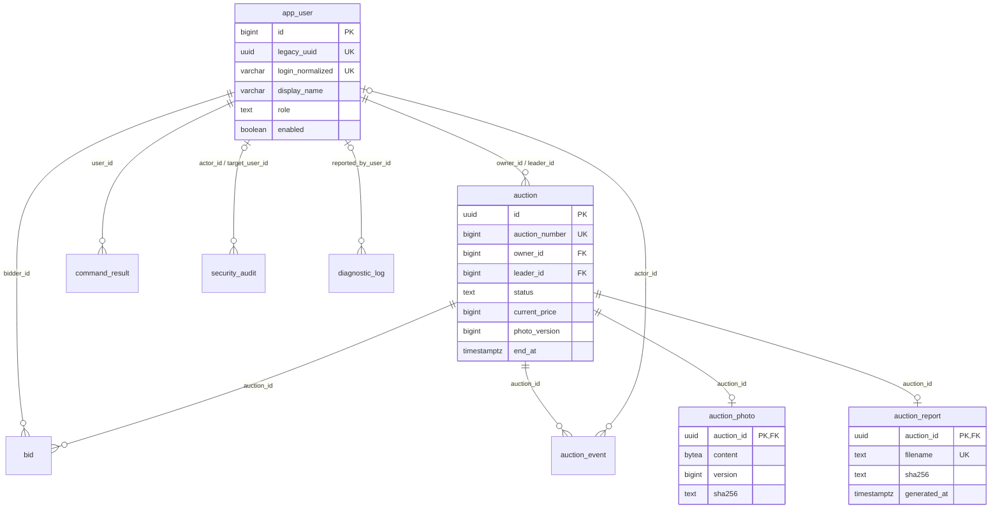

# Schemat bazy BidRoom 1.1

Otwórz [schemat SVG](database-schema.svg) — działa offline w przeglądarce i można go powiększać bez utraty jakości. Źródło struktury: migracje Flyway V001–V003. Poniżej ten sam model relacji w Mermaid.

`diagnostic_log.auction_id` pozostaje identyfikatorem zgłoszonym w logu, nie kluczem obcym: diagnostyka może dotyczyć odrzuconego żądania do nieistniejącej aukcji. Oferty, raporty i zdjęcia mają rzeczywiste FK. `flyway_schema_history` to dodatkowa tabela narzędzia migracji, pominięta na diagramie domeny.

Numer konta jest generowany przez PostgreSQL (`BIGINT IDENTITY`), więc nie trzeba odczytywać UUID użytkownika. Pole `legacy_uuid` zachowano tylko dla odzyskania oczekujących ofert z wersji 1.0. Aukcje mają czytelny `auction_number`, a trwały identyfikator techniczny UUID pozostaje bez zmiany.
